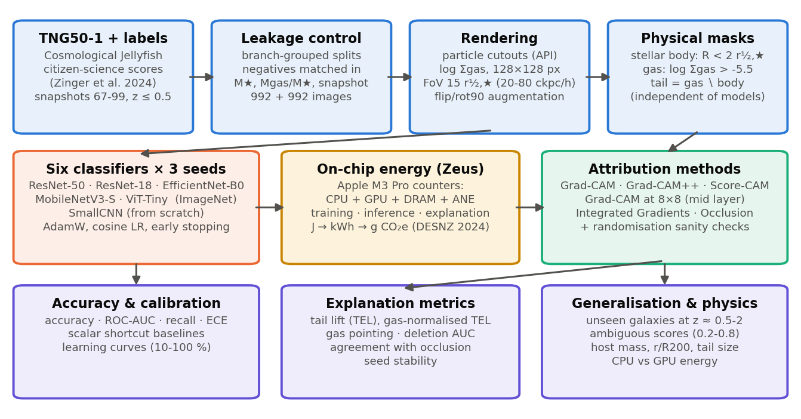
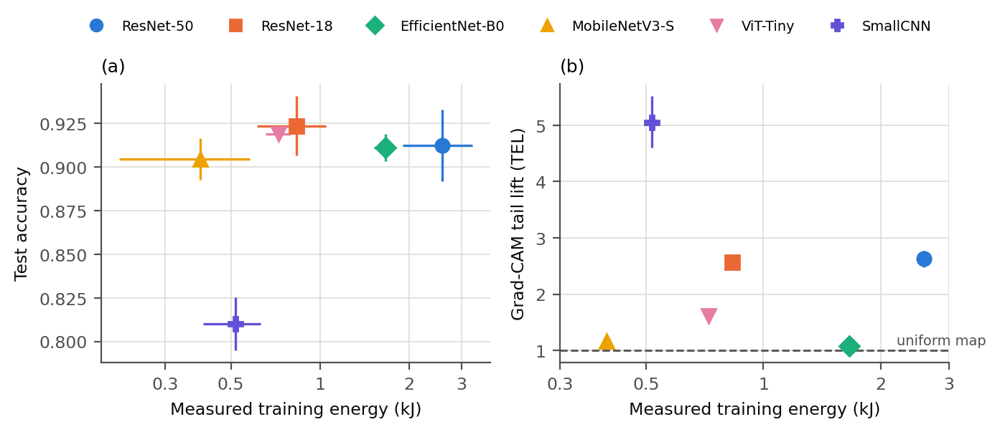

# Same answer, same reason? Green and explainable jellyfish galaxy classification

Code and results for a study of **accuracy, measured energy use and explanation fidelity** of compact deep learning models for classifying *jellyfish galaxies* (satellites whose gas is being stripped by ram pressure) in the **IllustrisTNG TNG50** cosmological simulation.

**Author:** Misbah Rafique, PhD researcher in AI & Data Science, University of Hull ([LinkedIn](https://www.linkedin.com/in/misbahrafique/))
**Status:** journal paper in preparation.



## What this project does
- **Data:** 1,984 gas-density maps of 1,778 TNG50 satellites, labelled by the Cosmological Jellyfish citizen-science project. Non-jellyfish are matched in stellar mass, gas fraction and snapshot to remove a gas-amount shortcut, and splits are grouped by galaxy to prevent leakage.
- **Models:** six architectures spanning a wide range of compute: ResNet-50, ResNet-18, EfficientNet-B0, MobileNetV3-Small, ViT-Tiny (ImageNet-pretrained, via `timm`) and a small CNN trained from scratch. Three seeds each, in PyTorch.
- **Energy:** training, inference and explanation energy measured from on-chip counters (CPU, GPU, DRAM, ANE) with [Zeus](https://ml.energy/zeus/) on Apple silicon, without admin rights.
- **Explainability:** six attribution methods (Grad-CAM, Grad-CAM++, Score-CAM, Grad-CAM at a higher-resolution layer, Integrated Gradients, occlusion), scored against **physical masks** of the stellar body and stripped gas from the simulation, with deletion curves, parameter-randomisation sanity checks and agreement with occlusion.
- **Generalisation:** held-out galaxies at higher redshift (z ≈ 0.5–2) and galaxies with ambiguous volunteer scores.

## Key results (test set, mean of 3 seeds)
| Model | Accuracy | AUC | Params (M) | GFLOPs | Training energy (kJ) |
|---|---|---|---|---|---|
| ResNet-50 | 0.912 ± 0.021 | 0.966 | 23.51 | 2.618 | 2.58 |
| ResNet-18 | 0.924 ± 0.017 | 0.971 | 11.17 | 1.133 | 0.83 |
| EfficientNet-B0 | 0.911 ± 0.008 | 0.950 | 4.01 | 0.247 | 1.66 |
| MobileNetV3-Small | 0.905 ± 0.012 | 0.953 | 1.52 | 0.035 | 0.39 |
| ViT-Tiny | 0.919 ± 0.003 | 0.961 | 5.40 | 0.696 | 0.72 |
| SmallCNN (from scratch) | 0.810 ± 0.015 | 0.904 | 0.29 | 0.420 | 0.52 |

- **ResNet-18 is the most accurate model and uses about 3.1× less training energy than ResNet-50.**
- Standard Grad-CAM suggests the efficient models ignore the stripped tail, but this is largely a **failure of the explanation**: occlusion shows that every model relies on the gas.
- Producing explanations costs from about **3 to more than 2,000 times** the energy of inference, depending on the method.
- On unseen higher-redshift galaxies, accuracy falls by 3.5–6.4 points, while explanations transfer.



## Repository layout
```
src/
  tng_data.py         sample selection, TNG API download, map rendering (resumable)
  match_negatives.py  matched non-jellyfish sample (removes the gas-amount shortcut)
  data.py             dataset, galaxy-grouped splits, physical body/gas/tail masks
  models.py           the six models, FLOPs, CAM target layers
  train.py            training and evaluation with energy measurement
  energy.py           Zeus on-chip energy measurement (CodeCarbon fallback)
  xai.py              attribution methods and explanation metrics
  journal.py, extended.py, journal_figs.py, fig_pipeline.py   experiments, figures and tables
notebooks/            01 build dataset -> 02 train and energy -> 03 explanations -> 04 figures and tables -> 05 extended analysis
results/              CSV/JSON results, LaTeX tables and figures (PDF/PNG)
```
Model checkpoints and the simulation data are not included because of their size.

## Reproducing
1. Create an environment with Python 3 and install the dependencies: `pip install -r requirements.txt`
2. Register for a free [IllustrisTNG API key](https://www.tng-project.org/data/) and put it in a `.env` file in the project root (see `.env.example`). **Never commit this file.**
3. Run the notebooks in order (`01` to `05`). The data download is resumable.

For accurate energy figures, keep the machine on mains power with other applications closed.

## Data and acknowledgements
Simulation data: IllustrisTNG / TNG50 (Pillepich et al. 2019; Nelson et al. 2019). Labels: Cosmological Jellyfish project (Zinger et al. 2024).

## Contact
Misbah Rafique: m.rafique-2021@hull.ac.uk
